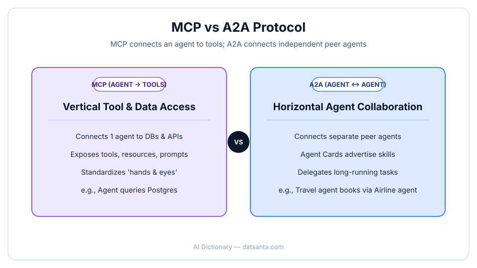

# A2A Protocol (Agent-to-Agent Protocol)

**A2A (Agent-to-Agent)** is an open communication protocol that lets independent AI agents built by different teams or frameworks discover each other's capabilities, exchange tasks, and collaborate over standard HTTP/JSON.

## Everyday example

In an airport, pilots, baggage handlers, and air traffic control work for different companies, yet they coordinate smoothly because everyone speaks standard aviation radio protocols. A2A works the same way for software agents: a travel-planning agent can hand a booking subtask to a partner airline agent via its published Agent Card without sharing internal prompts or source code.

## Don't confuse with

- **[MCP (Model Context Protocol)](mcp.md):** MCP connects one agent to external *tools and data sources* (vertical); A2A connects *peer agents* to delegate tasks to one another (horizontal).

## Related terms

- [MCP](mcp.md)
- [Multi-Agent System](multi-agent-system.md)
- [Handoff](handoff.md)
