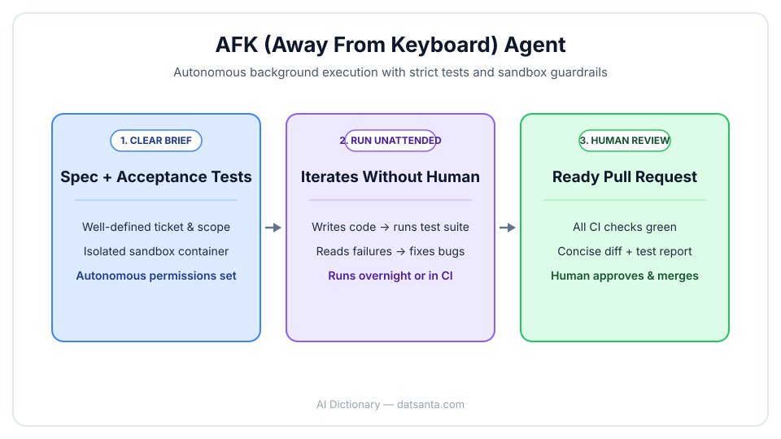

# AFK Agent (Away From Keyboard)

An **AFK agent** is an autonomous coding workflow launched to run in the background—without a human watching or clicking approve on every step—often inside an isolated [sandbox](sandbox.md) or CI job until it opens a pull request.

## Everyday example

Interactive AI coding is like driving a car with both hands on the wheel; an AFK agent is like loading the dishwasher before bed and waking up to clean plates. You hand it a crystal-clear [spec](spec.md), strict automated tests, and a locked sandbox, then let it iterate overnight on migrations, test coverage, or bug fixes while you work on harder design problems.

## Don't confuse with

- **[Human-in-the-Loop](human-in-the-loop.md):** Human-in-the-loop pairs a person interactively with the agent during execution; AFK agents run unattended inside guardrails and wait for human review only at the final pull request.

## Related terms

- [Dark Factory](dark-factory.md)
- [Sandbox](sandbox.md)
- [Spec](spec.md)
