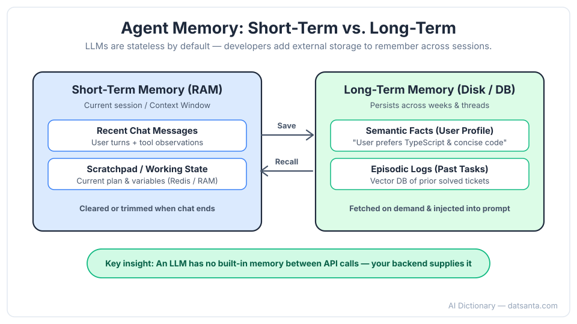

# Agent Memory

**Agent memory** is the storage layer developers build around stateless [LLMs](llm.md) so an [AI agent](ai-agent.md) can retain working state during a task (short-term) and recall facts across past sessions (long-term).

## Everyday example

An LLM API is like a helpful consultant with total amnesia between phone calls. Short-term memory keeps notes on the desk during today's call (recent messages and scratchpad variables inside the [context window](context-window.md) or Redis).

Long-term memory is a filing cabinet saved in a database or [vector database](vector-database.md) — storing semantic preferences (*"User prefers TypeScript"*) and episodic logs of past tickets to recall weeks later.

## Don't confuse with

- **Model weights (training):** Training bakes general knowledge into weights once; agent memory stores user-specific facts in your database that update immediately without retraining.
- **[RAG](rag.md):** RAG usually retrieves static company documents; agent memory reads and writes dynamic facts learned from ongoing user interactions.

## Related terms

- [AI Agent](ai-agent.md)
- [Context Window](context-window.md)
- [Vector Database](vector-database.md)
- [RAG](rag.md)
