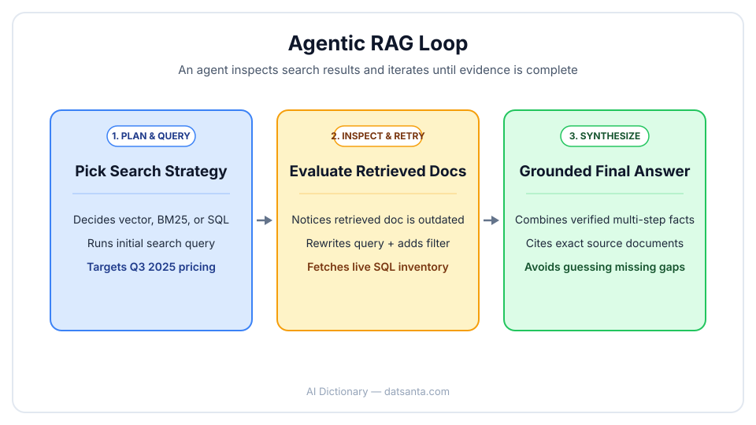

# Agentic RAG

**Agentic RAG** replaces a rigid single-shot retrieve-then-answer pipeline with an AI agent that plans searches, inspects retrieved chunks, rewrites weak queries, or checks multiple tools until it has enough evidence to answer.

## Everyday example

Standard RAG is like grabbing the top five books a librarian hands you and immediately writing a report, even if three books are off-topic. Agentic RAG acts like a real researcher: it checks the first search, notices pricing changed in Q3, runs a second search filtered to `2025`, queries a SQL table for live stock, and only then writes the final answer.

## Don't confuse with

- **[GraphRAG](graph-rag.md):** GraphRAG changes *how knowledge is stored and linked* (a graph); agentic RAG changes *how retrieval is orchestrated* (iterative tool-calling loops).

## Related terms

- [RAG](rag.md)
- [ReAct Pattern](react-pattern.md)
- [Query Rewriting](query-rewriting.md)
