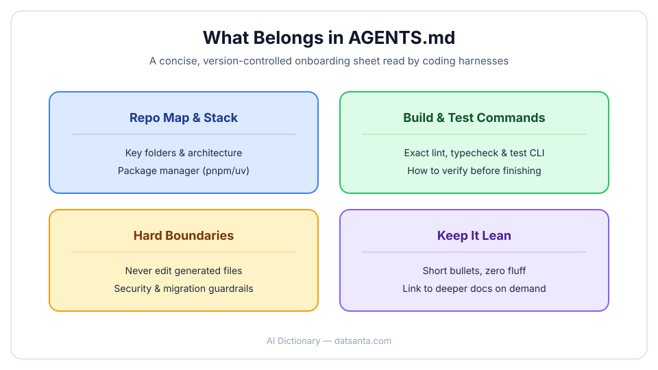

# AGENTS.md

**`AGENTS.md`** (similar to `CLAUDE.md`) is a plain Markdown instruction file placed inside a code repository that tells AI coding [harnesses](harness.md) how the project is structured, which commands run tests, and which coding rules must always be followed.

## Everyday example

When a new engineer joins your team, you hand them a one-page onboarding cheat sheet: `"Use pnpm, never edit generated migrations, run vitest before committing."` `AGENTS.md` is that exact onboarding sheet for AI coding agents. The harness automatically loads it at session start so you never have to repeat the same repo rules in every prompt—and keeping it concise prevents bloating the [smart zone](smart-zone.md).

## Don't confuse with

- **[System Prompt](system-prompt.md):** The system prompt is the built-in instruction written by the AI tool's maker; `AGENTS.md` is the *project-specific* rulebook written and version-controlled by your own engineering team.

## Related terms

- [Harness](harness.md)
- [Skill](skill.md)
- [Progressive Disclosure](progressive-disclosure.md)
