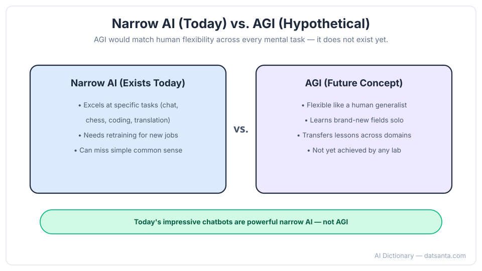

# AGI (Artificial General Intelligence)

**AGI** is a hypothetical future form of AI that could understand, learn, and perform *any* intellectual task a human can do — adapting flexibly across completely unfamiliar fields without being retrained for each one.

## Everyday example

Today's AI is **narrow AI** (even very broad [LLMs](llm.md)): an AI can beat world champions at chess or write clean code, yet still stumble on simple common-sense tasks outside its training or fail to learn a brand-new job on its own.

AGI would be like a capable human generalist — able to learn accounting this morning, debug plumbing schematics this afternoon, and transfer lessons from one domain to another naturally. It does not exist yet.

## Don't confuse with

- **Today's [LLMs](llm.md) or [AI agents](ai-agent.md):** Modern chatbots sound remarkably human, yet they still lack genuine understanding, self-directed learning, and reliable common sense across every domain.
- **Science-fiction consciousness:** AGI refers to *general problem-solving capability*, not necessarily human emotions or self-awareness.

## Related terms

- [AI](ai.md)
- [Foundation Model](foundation-model.md)
- [AI Alignment](ai-alignment.md)
- [Reasoning Model](reasoning-model.md)
