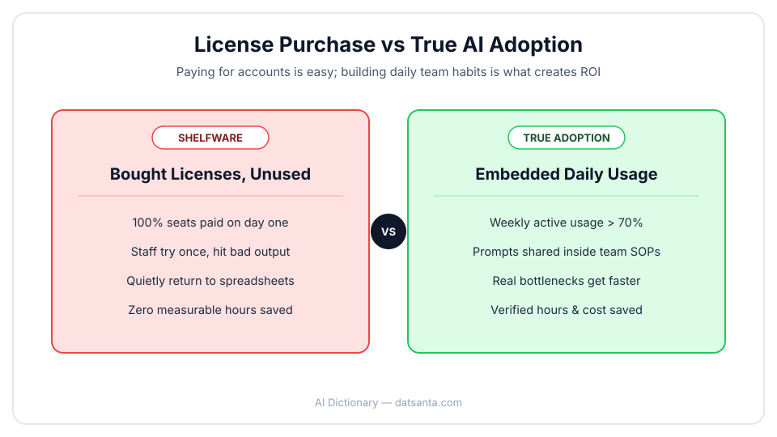

# AI Adoption

**AI adoption** is how widely and consistently people in an organization actually use AI tools in their daily work, rather than just signing up for an account or testing a demo once.

## Everyday example

Buying gym memberships for all 200 employees does not make the company healthier. Real fitness adoption happens when staff show up three times a week because the gym fits their schedule and feels easy to use. Similarly, paying for AI licenses means nothing if employees quietly go back to manual spreadsheets after week two. True AI adoption shows up in weekly active usage, shared workflows, and measurable time saved.

## Don't confuse with

- **[AI Enablement](ai-enablement.md):** Enablement provides the training, guardrails, and tools; adoption is whether employees actually use them every day.

## Related terms

- [Change Management](change-management.md)
- [AI Pilot](ai-pilot.md)
- [Productivity J-Curve](productivity-j-curve.md)
