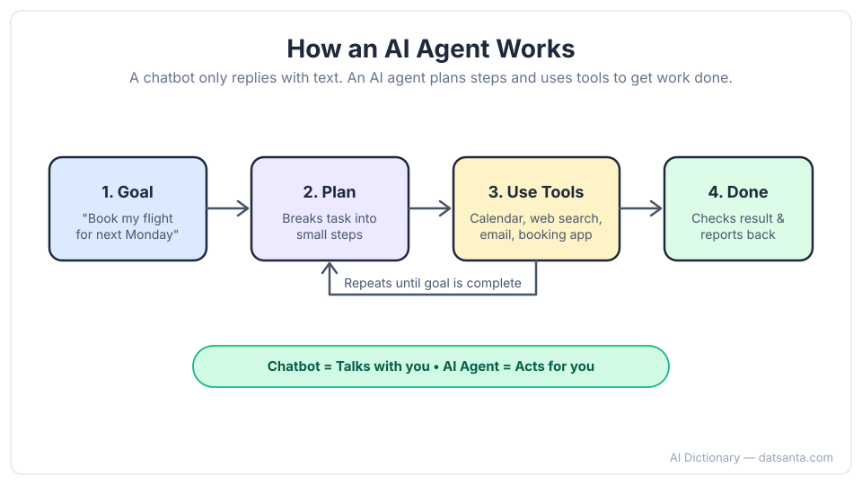

# AI Agent

An **AI agent** is an AI system that does not just chat — it can plan steps, use external tools, and take actions to finish a goal on its own.

## Everyday example

A regular chatbot is like an advisor on the phone: you ask *"Where should I eat tonight?"* and it gives you three ideas, then you do the rest.

An AI agent is like a personal assistant: you say *"Book a quiet table for two at 7 PM near the office,"* and it checks your calendar, searches restaurants, picks one that fits, and sends you the confirmation.

## Don't confuse with

- **Chatbot:** A chatbot waits for your message and replies with text; an agent loops through planning, using tools (like search, email, or code), and checking its own work.
- **Automation script:** A traditional script follows one rigid path; an agent adapts its plan when something unexpected happens.

## Related terms

- [LLM](llm.md)
- [Prompt](prompt.md)
- [RAG](rag.md)
