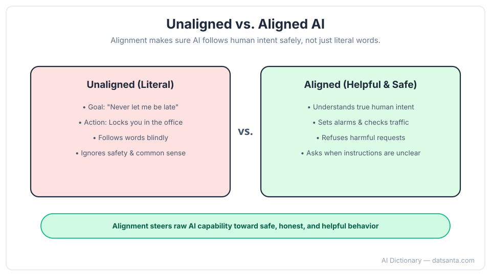

# AI Alignment

**AI alignment** is the practice of making sure AI systems actually do what humans intend — remaining helpful, honest, and safe rather than following literal instructions in harmful or unexpected ways.

## Everyday example

Think of the classic genie story: you wish *"Make sure I'm never late for work again,"* and a literal, unaligned genie locks you inside your office forever. Technically it met the goal, yet missed what you actually meant.

AI researchers use alignment techniques like [RLHF](rlhf.md) and [guardrails](guardrails.md) so models respect human values, refuse dangerous requests, and ask for clarification instead of taking reckless shortcuts.

## Don't confuse with

- **Raw intelligence:** A smarter model is not automatically safer; alignment specifically steers *how* that capability is used.
- **Censorship:** Good alignment stops genuine harm (like malware or self-harm instructions) while keeping the AI genuinely useful for normal questions.

## Related terms

- [RLHF](rlhf.md)
- [Guardrails](guardrails.md)
- [Jailbreak](jailbreak.md)
- [AI Bias](ai-bias.md)
