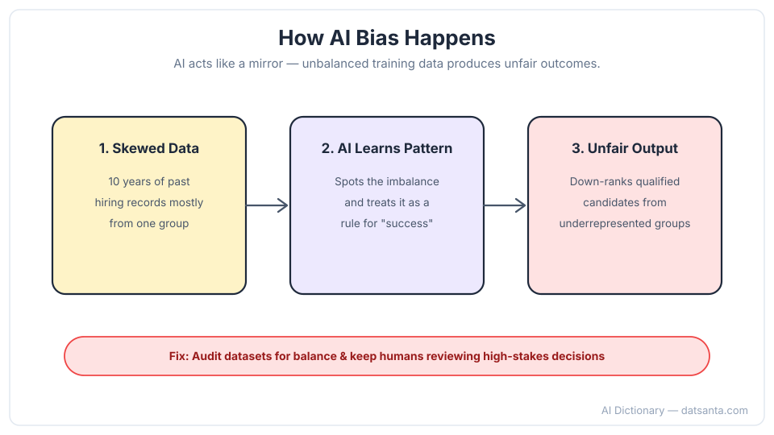

# AI Bias

**AI bias** happens when an AI system produces unfair, skewed, or stereotyped results because it learned from unbalanced or prejudiced human examples in its [training data](training-data.md).

## Everyday example

Suppose a company trains a resume-screening AI using 10 years of past hiring records from a department that historically hired mostly men. Without being told to discriminate, the AI spots that pattern and quietly down-ranks qualified female applicants.

AI is not "objective" just because it runs on math — it acts like a mirror reflecting whatever blind spots exist in the data we feed it.

## Don't confuse with

- **[Hallucination](hallucination.md):** Hallucination is inventing a fake fact; AI bias is systematically favoring or disadvantaging certain groups, languages, or viewpoints.
- **Personal opinion:** AI has no feelings or malice — bias comes from skewed data, missing representation, or flawed design choices.

## Related terms

- [Training Data](training-data.md)
- [AI Alignment](ai-alignment.md)
- [AI Governance](ai-governance.md)
- [AI Literacy](ai-literacy.md)
