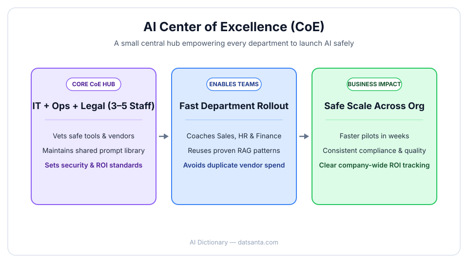

# AI Center of Excellence (CoE)

An **AI Center of Excellence (CoE)** is a small, cross-functional core team inside a company that sets AI standards, shares proven templates, vets tools, and coaches departments so teams do not reinvent the wheel.

## Everyday example

Instead of letting marketing, HR, and finance each spend months negotiating with separate AI vendors and making the same security mistakes, a CoE acts like a shared pit crew. Maybe three to five people from IT, operations, and legal maintain approved tools, evaluate new pilots, and help each department launch safely in weeks instead of months.

## Don't confuse with

- **[AI Champion](ai-champion.md):** A CoE is the central governing and support hub; an AI champion is a frontline peer embedded inside an individual department like sales or support.

## Related terms

- [AI Enablement](ai-enablement.md)
- [AI Governance](ai-governance.md)
- [AI Champion](ai-champion.md)
