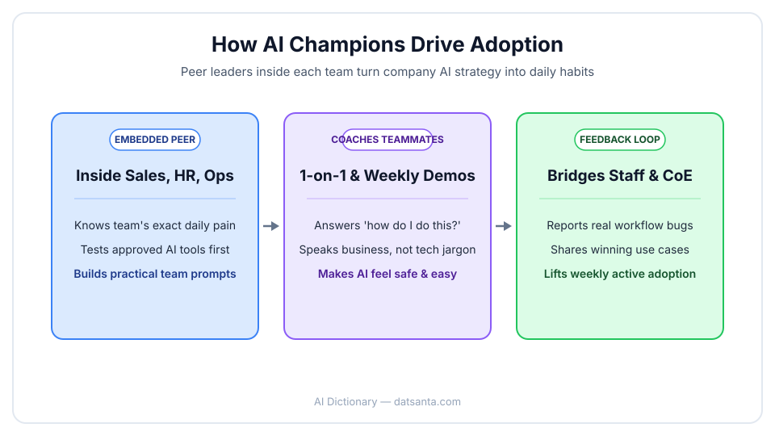

# AI Champion

An **AI champion** is an enthusiastic, practical employee inside a non-technical team—such as sales, HR, or accounting—who tests AI workflows early and helps coworkers adopt them day to day.

## Everyday example

When a hospital introduces new scheduling software, doctors rarely read a 60-page IT manual. They ask the one colleague on their floor who already mastered it and knows their exact daily routine. An AI champion plays that peer role: they translate abstract AI capabilities into concrete shortcuts for their own department and feed real problems back to leadership.

## Don't confuse with

- **[AI Center of Excellence (CoE)](ai-center-of-excellence.md):** A CoE is the central specialist team setting company-wide rules and infrastructure; an AI champion is the trusted peer sitting right inside each business unit.

## Related terms

- [AI Adoption](ai-adoption.md)
- [Change Management](change-management.md)
- [AI Enablement](ai-enablement.md)
