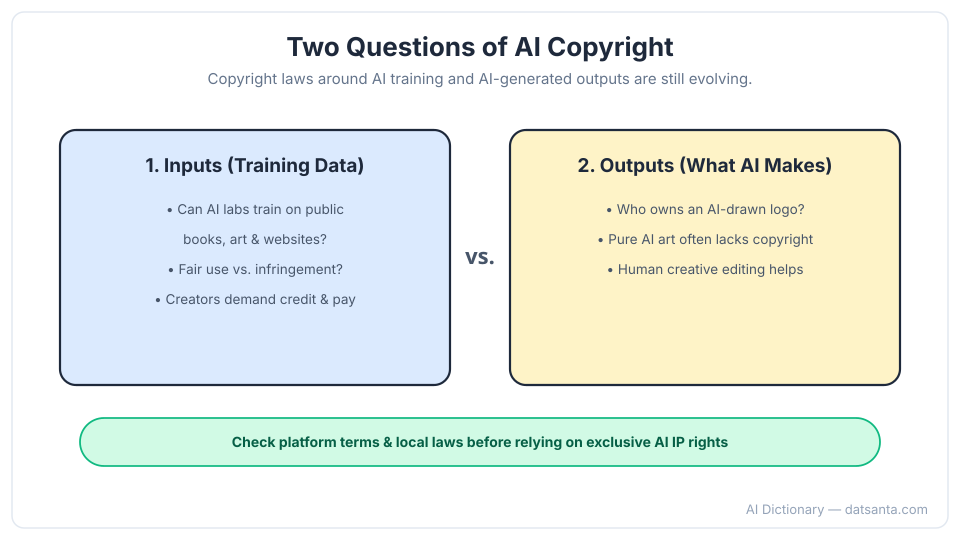

# AI Copyright

**AI copyright** covers the legal questions around who owns AI-generated text, images, or music — and whether AI companies can legally use copyrighted books, photos, and art as [training data](training-data.md).

## Everyday example

Suppose you ask an AI to paint a coffee cup, then print it on T-shirts to sell. In many countries, purely AI-generated images with zero human creative editing cannot be copyrighted — meaning anyone else could copy that exact image too.

Meanwhile, authors and artists debate whether training AI on public books and artwork counts as fair use or copyright infringement. Laws vary by country and are still evolving.

## Don't confuse with

- **Software license (MIT / CC):** A license is a clear permission slip chosen by a creator; copyright is the automatic legal protection granted to original human-made work.
- **Commercial usage rights:** Even if an AI platform lets you use outputs commercially in its Terms of Service, copyright law may still refuse exclusive ownership if there was no meaningful human authorship.

## Related terms

- [Training Data](training-data.md)
- [Generative AI](generative-ai.md)
- [Responsible AI](responsible-ai.md)
- [AI Watermark](ai-watermark.md)
