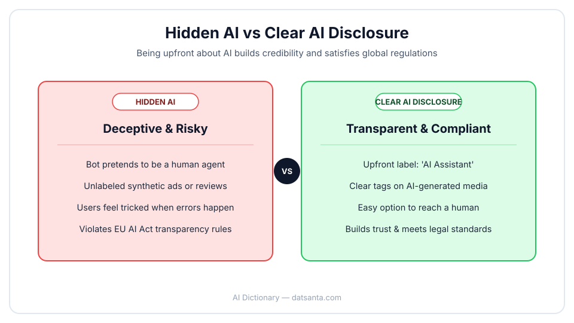

# AI Disclosure

**AI disclosure** is clearly informing customers, employees, or the public when they are interacting with an AI system or viewing AI-generated text, images, audio, or decisions.

## Everyday example

When you open a bank's support chat and the first line says, "Hi, I'm an AI assistant—type 'agent' anytime to reach a person," that is AI disclosure. Similarly, labeling synthetic product photos or notifying job applicants when automated screening is used prevents deception, satisfies laws like the EU AI Act, and avoids backlash when users realize a human did not write the message.

## Don't confuse with

- **[Customer Trust](customer-trust.md):** AI disclosure is the transparent label or notice itself; customer trust is the lasting confidence earned by being open and reliable.

## Related terms

- [Customer Trust](customer-trust.md)
- [EU AI Act](eu-ai-act.md)
- [Escalation Path](escalation-path.md)
