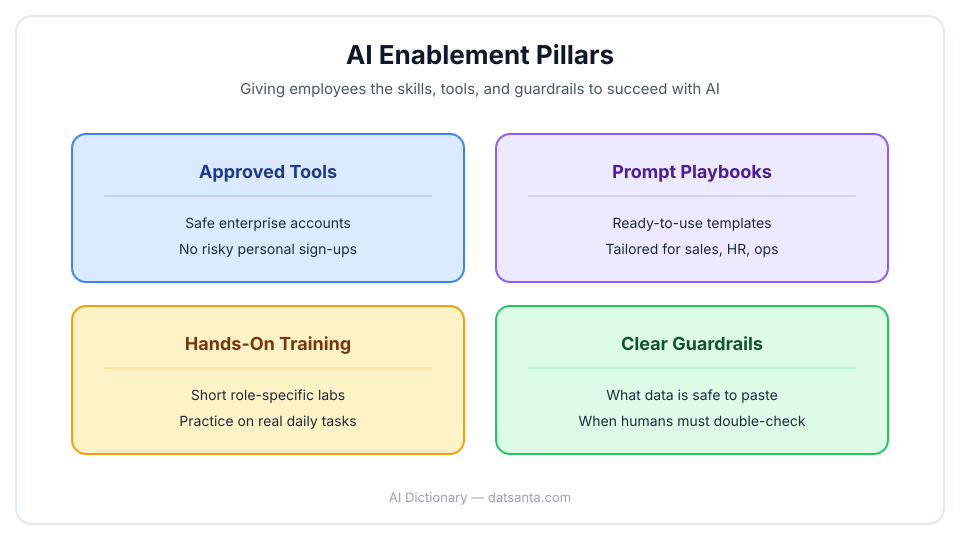

# AI Enablement

**AI enablement** is giving employees the practical training, approved tools, prompt templates, and safety rules they need so they can use AI confidently in their real jobs.

## Everyday example

Handing a new driver the keys to a fast car without lessons, road signs, or insurance leads to either crashes or a car parked forever in the garage. Enablement is the driving course, clear traffic rules, and practice lot. In a company, AI enablement means running role-specific workshops, sharing tested prompt libraries, and showing staff exactly what data is safe to paste.

## Don't confuse with

- **[AI Adoption](ai-adoption.md):** Enablement is the support system you build; adoption is the daily usage behavior that follows.

## Related terms

- [Change Management](change-management.md)
- [AI Readiness](ai-readiness.md)
- [AI Strategy](ai-strategy.md)
