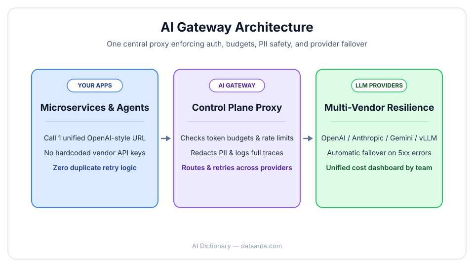

# AI Gateway

An **AI gateway** is a unified proxy server placed between your application code and external LLM providers—handling API keys, [rate limiting](rate-limiting.md), [fallback chains](fallback-chain.md), cost tracking, and [observability](observability.md) in one place.

## Everyday example

Instead of letting 15 microservices hardcode separate OpenAI, Anthropic, and Gemini SDKs with scattered API keys, every app calls one internal gateway endpoint. If Provider A goes down, the gateway automatically fails over to Provider B; if a prompt contains PII, it redacts it centrally; and finance gets one clean dashboard showing token spend per feature.

## Don't confuse with

- **[Model Routing](model-routing.md):** Model routing is a smart decision rule choosing *which* model fits a prompt's difficulty; an AI gateway is the central infrastructure proxy that enforces auth, budgets, logs, and routing rules.

## Related terms

- [Fallback Chain](fallback-chain.md)
- [Model Routing](model-routing.md)
- [Observability](observability.md)
