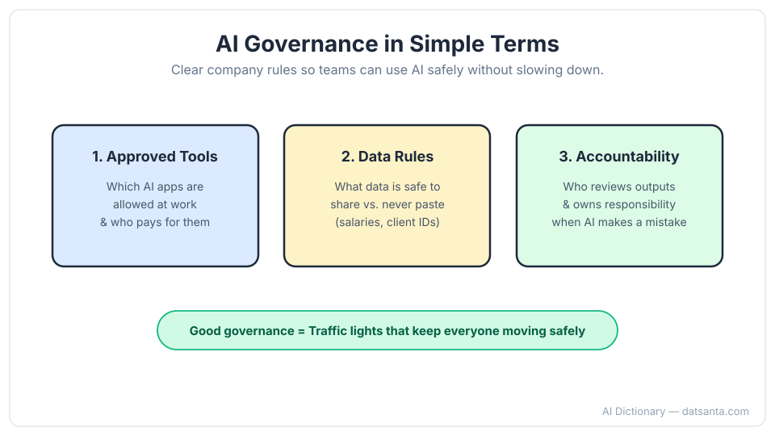

# AI Governance

**AI governance** is the set of clear rules a company uses to decide which AI tools are approved, what data is safe to share with them, and who is accountable when AI makes a mistake.

## Everyday example

Think of traffic laws, seatbelts, and driver's licenses. They are not meant to stop cars from moving — they exist so everyone can drive faster without crashing into each other.

Good AI governance does the same for a business. Instead of a 100-page legal binder nobody reads, it can be a simple one-page guide: *"Use our company AI account, never paste customer IDs, and always review AI drafts before sending."*

## Don't confuse with

- **Banning AI:** Saying "nobody can use AI" is not governance; it usually pushes employees into [shadow AI](shadow-ai.md).
- **[Guardrails](guardrails.md):** Governance is the company's human policy and oversight; guardrails are the technical software filters built into an AI app.

## Related terms

- [Shadow AI](shadow-ai.md)
- [Data Privacy](data-privacy.md)
- [Guardrails](guardrails.md)
- [Human-in-the-Loop](human-in-the-loop.md)
