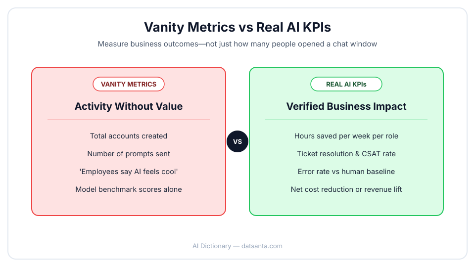

# AI KPI

An **AI KPI (Key Performance Indicator)** is a concrete, measurable number used to track whether an AI project is actually delivering business value—such as hours saved, ticket resolution rate, or error reduction.

## Everyday example

Saying "our new sales AI feels helpful" is an opinion, not a KPI. Tracking that "proposal drafting time dropped from 90 minutes to 25 minutes while win rates stayed above 22%" is an AI KPI. Good teams pick two or three business KPIs before starting an AI pilot so everyone agrees on what success or failure looks like after 30 days.

## Don't confuse with

- **[Benchmark](benchmark.md):** A benchmark tests general model intelligence on standard academic or coding tasks; an AI KPI measures real business impact inside your company.

## Related terms

- [AI Pilot](ai-pilot.md)
- [AI ROI](ai-roi.md)
- [Productivity J-Curve](productivity-j-curve.md)
