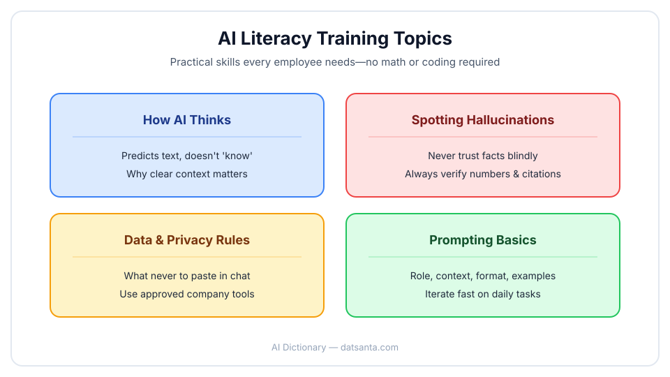

# AI Literacy Training

**AI literacy training** teaches everyday employees how AI works at a practical level—what it is good at, why it sometimes hallucinates, how to write clear prompts, and what data must never be shared.

## Everyday example

Teaching staff to drive safely does not mean turning everyone into an auto mechanic who can rebuild an engine. Similarly, AI literacy training does not require teaching math or Python to marketers and accountants. A focused two-hour workshop showing real examples of hallucinations, privacy rules, and verification habits makes the whole company dramatically faster and safer.

## Don't confuse with

- **[AI Enablement](ai-enablement.md):** AI literacy training builds baseline understanding and safe habits; enablement goes further by providing approved tools, team templates, and integrated workflows.

## Related terms

- [AI Enablement](ai-enablement.md)
- [Shadow IT](shadow-it.md)
- [Hallucination](hallucination.md)
