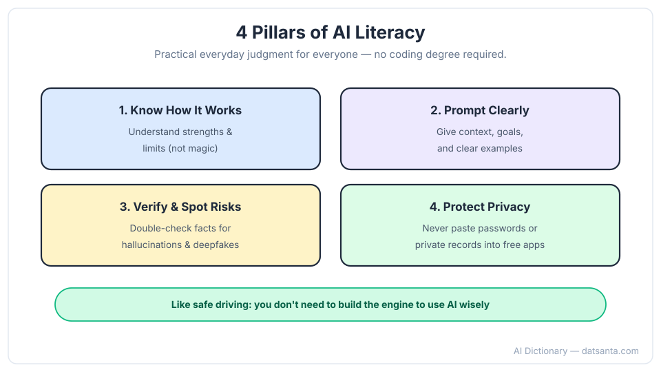

# AI Literacy

**AI literacy** is the practical everyday skill of understanding what AI can and cannot do, using AI tools effectively, spotting mistakes like [hallucinations](hallucination.md) or [deepfakes](deepfake.md), and protecting your privacy.

## Everyday example

Just as driving safely does not require knowing how to build a car engine — only traffic rules, mirrors, and braking distance — AI literacy does not require a computer science degree.

An AI-literate person writes clear [prompts](prompt.md), double-checks facts before quoting an AI, never pastes passwords or private client records into random free apps, and knows when a task is better done by a human.

## Don't confuse with

- **AI engineering / Coding:** Engineers build and deploy models in code; AI literacy is for *everyone* — students, teachers, managers, and everyday citizens.
- **Blindly trusting or blindly fearing AI:** True AI literacy sits calmly in the middle: using AI where it saves real time while staying skeptical where stakes are high.

## Related terms

- [Prompt Engineering](prompt-engineering.md)
- [Hallucination](hallucination.md)
- [Deepfake](deepfake.md)
- [AI Bias](ai-bias.md)
