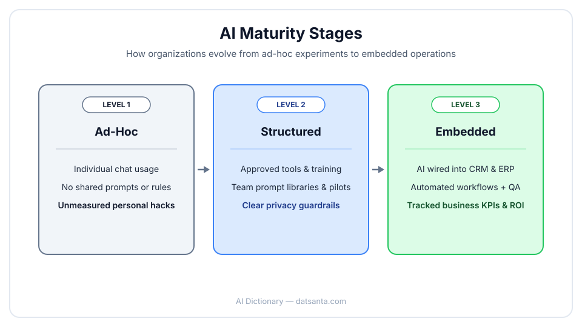

# AI Maturity

**AI maturity** measures how far an organization has progressed in using AI — from scattered personal experiments all the way to governed, automated workflows delivering measurable [AI ROI](ai-roi.md).

## Everyday example

Think of fitness levels: going from *"bought running shoes"* (Stage 1) to *"running 5K twice a week"* (Stage 3) to *"training with a structured marathon plan"* (Stage 5).

Most companies sit at Stage 1 or 2 — individuals use [chatbots](chatbot.md) ad hoc, often creating [shadow AI](shadow-ai.md). Moving up means organizing clean data, setting clear [AI governance](ai-governance.md), and embedding AI into core processes.

## Don't confuse with

- **AI hype or budget size:** Spending millions on flashy tools with messy data and zero adoption is still low AI maturity.
- **[AI readiness](ai-readiness.md):** Readiness checks whether your data, systems, and team are *prepared to start*; maturity tracks how *embedded and effective* AI already is across the company.

## Related terms

- [AI Readiness](ai-readiness.md)
- [AI Strategy](ai-strategy.md)
- [AI Governance](ai-governance.md)
- [AI Adoption](ai-adoption.md)
