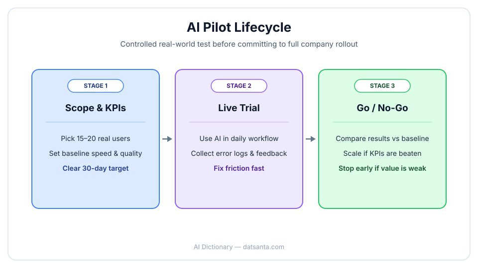

# AI Pilot

An **AI pilot** is a controlled, real-world trial where a small team or subset of customers uses a working AI solution for 4 to 8 weeks to measure actual time saved, error rates, and [AI ROI](ai-roi.md) before a company-wide rollout.

## Everyday example

Instead of replacing every cashier register across 50 stores overnight, a retail chain tests self-checkout AI in 2 stores first — tracking queue speed, customer frustration, and shrinkage.

If the 2-store pilot hits its [KPI](ai-kpi.md) targets and staff adapt smoothly, leadership rolls it out to all 50 stores with confidence.

## Don't confuse with

- **[Proof of Concept (POC)](proof-of-concept.md):** A POC checks if the tech works at all in a lab; a pilot tests real users, real workflows, and real business impact.
- **Permanent launch:** A pilot always has a clear start date, end date, success metrics, and a go/no-go decision — otherwise it becomes "pilot purgatory."

## Related terms

- [Proof of Concept (POC)](proof-of-concept.md)
- [AI KPI](ai-kpi.md)
- [Change Management](change-management.md)
- [AI Adoption](ai-adoption.md)
