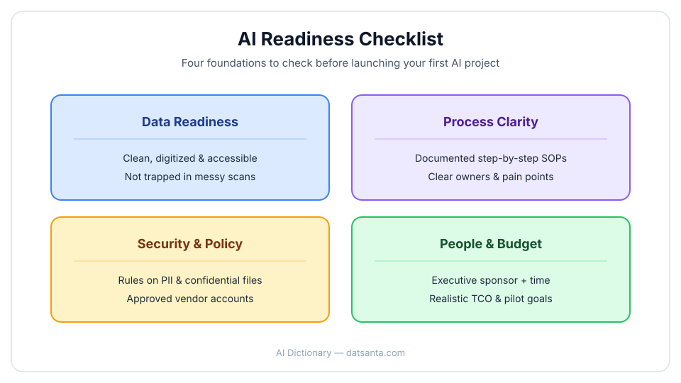

# AI Readiness

**AI readiness** is an honest check of whether your business has the clean data, connected software, budget, and team skills needed for an AI project to succeed before you start building.

## Everyday example

Installing a smart dishwasher in a kitchen with no plumbing or electricity wastes money. Similarly, launching an AI support bot when your company policies live in 20 outdated, conflicting Word files guarantees bad answers.

An AI readiness check asks four things first: Is our data accurate and accessible? Do our apps have APIs? Do we have a clear owner? And do staff know what problem we are solving?

## Don't confuse with

- **Buying AI licenses:** Paying for team seats takes 5 minutes; being AI-ready means your underlying documents and processes are clean enough for AI to actually help.
- **[AI maturity](ai-maturity.md):** Readiness is the *pre-flight check* before takeoff; maturity is how smoothly AI already runs across the business.

## Related terms

- [AI Maturity](ai-maturity.md)
- [AI Strategy](ai-strategy.md)
- [Proof of Concept (POC)](proof-of-concept.md)
- [AI Governance](ai-governance.md)
