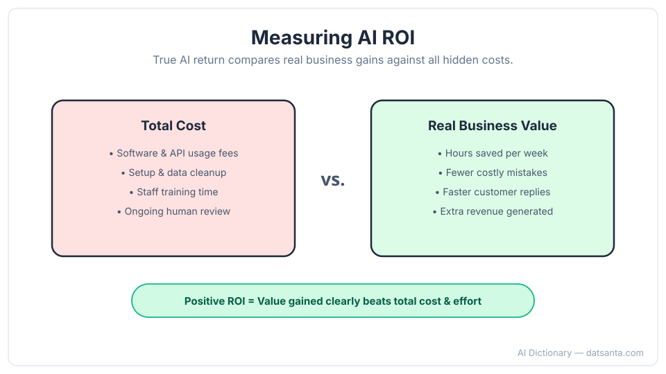

# AI ROI

**AI ROI** (Return on Investment) measures whether an AI project actually saves or earns more money than it costs to build, run, and maintain. Positive ROI means real business value, not just an impressive demo.

## Everyday example

Suppose a support tool costs $500 a month and takes 40 hours to set up. If it only saves your team 2 hours a month, the math does not work.

On the other hand, if it cuts invoice processing from 3 hours a day to 20 minutes — and reduces billing errors — the payback is clear within weeks. Always count hidden costs like data cleanup, staff training, and human review time.

## Don't confuse with

- **Usage rate:** Having 90% of staff open a chatbot once a week does not equal ROI; what matters is measurable time saved, revenue added, or errors prevented.
- **Software subscription price:** The monthly license is only one piece; setup, integration, and ongoing checking often cost more than the AI itself.

## Related terms

- [Build vs. Buy](build-vs-buy.md)
- [AI Workflow](ai-workflow.md)
- [Human-in-the-Loop](human-in-the-loop.md)
