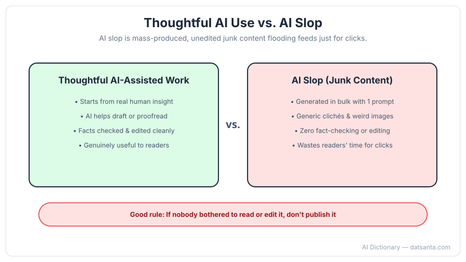

# AI Slop

**AI slop** is the flood of low-effort, repetitive, or misleading text, images, and videos generated in bulk by AI and dumped onto social media, blogs, and search results just to chase clicks.

## Everyday example

Think of junk mail stuffing your physical mailbox every day. On the internet, AI slop looks like bizarre AI-generated photos on Facebook feeds, robotic blog posts repeating *"In today's fast-paced world..."*, or fake travel guides written without ever visiting the city.

Just like fast-food spam, AI slop makes it harder to find trustworthy human experience and real reporting online.

## Don't confuse with

- **AI-assisted quality work:** Using AI to brainstorm, proofread, or illustrate a carefully researched article is helpful; AI slop skips human editing and fact-checking completely.
- **[Hallucination](hallucination.md):** Hallucination is an accidental factual error by a model; AI slop is a publishing habit of mass-producing shallow content without care.

## Related terms

- [Generative AI](generative-ai.md)
- [AI Watermark](ai-watermark.md)
- [AI Literacy](ai-literacy.md)
- [Hallucination](hallucination.md)
