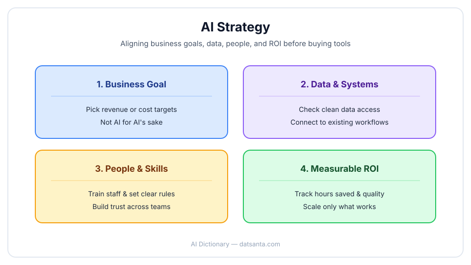

# AI Strategy

An **AI strategy** is a practical business plan that connects AI tools and investments directly to measurable company goals — such as cutting support wait times, lifting sales conversion, or speeding up operations.

## Everyday example

Buying AI subscriptions just because competitors talk about AI is like buying factory robots without knowing which product you are trying to make faster.

A clear AI strategy starts with three questions: Where are our biggest time or cost bottlenecks? Which 2–3 workflows will pay back fastest? And what data, budget, and [AI governance](ai-governance.md) rules do we need before scaling?

## Don't confuse with

- **An AI tool shopping list:** Subscribing to ChatGPT, Claude, or Gemini for every employee is tool access, not a strategy tied to business outcomes.
- **A 100-page theory deck:** Good AI strategy is a living 1–2 page roadmap focused on quarterly [AI ROI](ai-roi.md) targets, not buzzwords.

## Related terms

- [AI ROI](ai-roi.md)
- [Use-Case Prioritization](use-case-prioritization.md)
- [AI Readiness](ai-readiness.md)
- [AI Governance](ai-governance.md)
