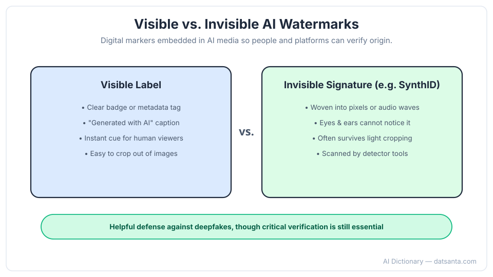

# AI Watermark

An **AI watermark** is a visible label or an invisible digital signature embedded inside an AI-generated image, video, audio clip, or text so platforms and people can verify it was created by AI.

## Everyday example

Just as paper banknotes have hidden security threads that show up under UV light, modern AI tools like SynthID weave tiny, invisible pixel or audio patterns into generated media.

Your eyes cannot see the watermark, and it often survives cropping or light compression — yet a detector tool can scan the file and flag *"Generated by AI,"* helping fight [deepfakes](deepfake.md) and misinformation.

## Don't confuse with

- **Stock-photo logo stamps:** Big translucent logos across a preview photo are meant to block copying; invisible AI watermarks preserve image quality while proving origin.
- **100% foolproof proof:** No watermark is unbreakable yet, and text watermarks are especially easy to erase by paraphrasing — so critical thinking still matters.

## Related terms

- [Deepfake](deepfake.md)
- [Text-to-Image](text-to-image.md)
- [AI Literacy](ai-literacy.md)
- [Diffusion Model](diffusion-model.md)
