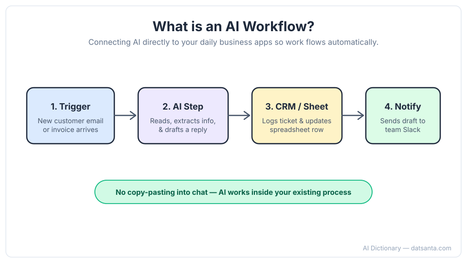

# AI Workflow

An **AI workflow** connects AI directly into your existing business tools — like email, CRM, or spreadsheets — so repetitive steps run automatically in sequence without manual copy-pasting.

## Everyday example

Copying customer emails one by one into ChatGPT, waiting for a reply, and pasting it back into your helpdesk is like carrying water in buckets.

An AI workflow builds the pipe: whenever a support email arrives, AI reads it, checks your refund policy, updates a row in your CRM, and posts a ready-to-approve draft in Slack. Your team saves hours every day without switching tabs.

## Don't confuse with

- **AI chat:** Chatting in a browser window is manual and depends on one person typing prompts; an AI workflow runs automatically inside your daily process.
- **[AI agent](ai-agent.md):** An AI workflow follows fixed, predictable steps you design; an AI agent decides its own next steps dynamically when a task is open-ended.

## Related terms

- [AI Agent](ai-agent.md)
- [AI ROI](ai-roi.md)
- [Human-in-the-Loop](human-in-the-loop.md)
