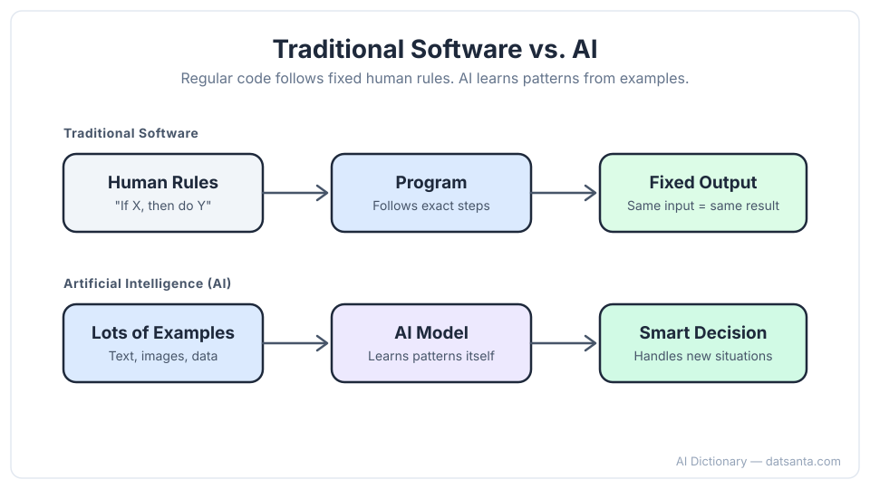

# AI (Artificial Intelligence)

**AI** is software built to perform tasks that normally require human thinking — such as understanding language, recognizing images, or making decisions. Instead of following rigid step-by-step rules, modern AI learns patterns from examples.

## Everyday example

Think of the difference between a vending machine and a barista. A vending machine follows fixed rules: press `B4`, get water. A barista listens to *"something iced and not too sweet"* and figures out what to make based on experience.

Traditional software works like the vending machine. AI works more like the barista — it handles messy, real-world requests by learning from thousands of past examples.

## Don't confuse with

- **[Machine learning](machine-learning.md):** The main method used to build modern AI, where computers learn from data rather than being explicitly programmed.
- **Automation:** Running fixed, repetitive steps (like sending an invoice every Friday) does not require AI.

## Related terms

- [Machine learning](machine-learning.md)
- [Generative AI](generative-ai.md)
- [LLM](llm.md)
