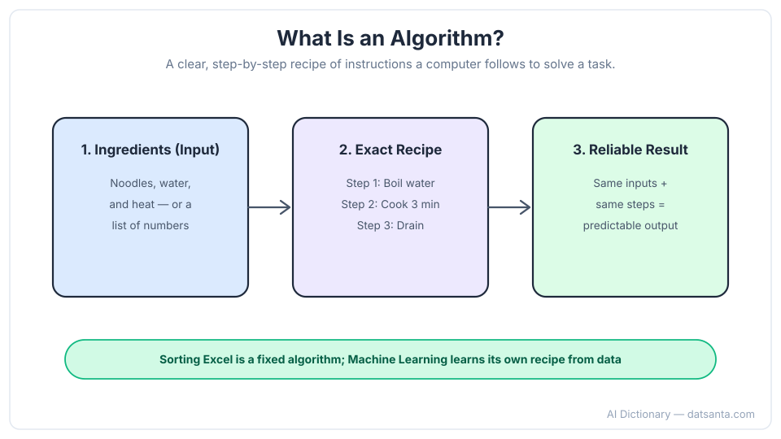

# Algorithm

An **algorithm** is a clear, step-by-step recipe of instructions that a computer follows to solve a problem, sort information, or reach a decision.

## Everyday example

A cooking recipe is an algorithm: boil water, add noodles, wait 3 minutes, drain. Follow the exact steps with the same ingredients and you get the same bowl of noodles every time.

Software uses algorithms everywhere — from finding the fastest route on Google Maps to deciding which videos show up next on your feed. In [machine learning](machine-learning.md), the algorithm is the learning procedure that studies examples to build an AI model.

## Don't confuse with

- **[AI](ai.md):** Every AI uses algorithms, yet most algorithms (like sorting a spreadsheet A–Z or calculating tax) are simple fixed math and have nothing to do with AI.
- **Model:** The algorithm is the *learning recipe* (how to study); the trained model is the *finished brain* saved after studying [training data](training-data.md).

## Related terms

- [AI](ai.md)
- [Machine Learning](machine-learning.md)
- [Automation](automation.md)
- [Recommendation System](recommendation-system.md)
