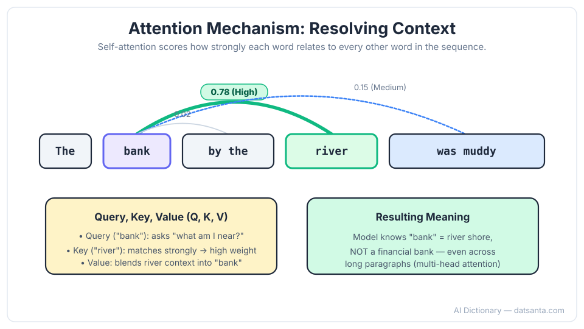

# Attention Mechanism

The **attention mechanism** lets a [Transformer](transformer.md) dynamically weigh how relevant every word in a sequence is to every other word, no matter how far apart they appear.

## Everyday example

When you read *"The bank by the river was muddy,"* your brain instantly links *"bank"* to *"river"* and *"muddy"* rather than thinking of a savings account.

Self-attention does this mathematically using **Query, Key, and Value** matrices. The token `"bank"` sends out a Query; `"river"` answers with a matching Key and gets a high weight (`0.78`), blending river context directly into `"bank"`'s internal representation.

## Don't confuse with

- **[Context window](context-window.md):** Context window is the maximum number of tokens allowed on the page; attention is the mechanism computing pairwise links inside that window (which is why memory scales fast on long prompts).
- **Static word vectors:** Older models gave `"bank"` one fixed vector regardless of context; attention updates its meaning dynamically per sentence.

## Related terms

- [Transformer](transformer.md)
- [Context Window](context-window.md)
- [Embeddings](embeddings.md)
