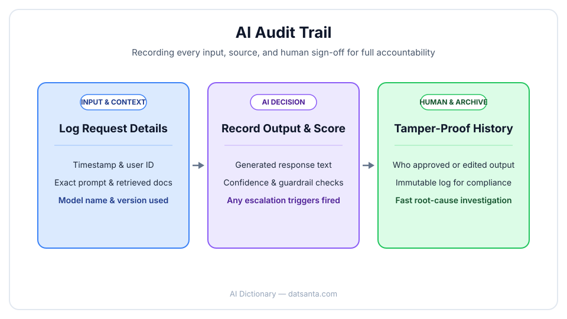

# Audit Trail

An **audit trail** is an automatic, tamper-resistant record showing who used an AI system, what inputs and documents were used, what the AI answered, and whether a human approved the final action.

## Everyday example

In a pharmacy, every prescription filled is logged with the patient's name, the time, the dosage, and the pharmacist who signed off—so if something goes wrong weeks later, investigators can trace exactly what happened. An AI audit trail works the same way: if an AI system issues a wrong refund or rejects a claim, your team can inspect the exact prompt, source document, and model version involved.

## Don't confuse with

- **[Post-Deployment Monitoring](post-deployment-monitoring.md):** Monitoring watches live dashboards for drops in speed or accuracy right now; an audit trail preserves a step-by-step historical record for compliance and investigation.

## Related terms

- [Compliance](compliance.md)
- [Model Risk Management](model-risk-management.md)
- [Data Governance](data-governance.md)
