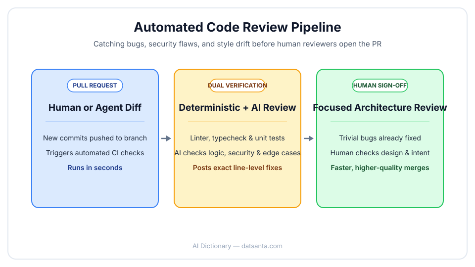

# Automated Code Review

**Automated code review** uses AI agents alongside deterministic linters, typecheckers, and unit tests to inspect every pull request for bugs, security holes, and style drift before a human engineer even opens the diff.

## Everyday example

Before an airplane pilot climbs into the cockpit, ground mechanics run automated sensor diagnostics across every engine and hydraulic line so the pilot focuses on judgment calls instead of checking every bolt manually. When AI coding agents generate ten times more pull requests, automated review catches missing error handling, leaked secrets, and broken invariants immediately so human reviewers stay sharp on architecture.

## Don't confuse with

- **[AI Regression Testing](regression-testing.md):** Regression testing scores *AI model outputs* against a golden dataset; automated code review inspects *source code diffs* in a repository for bugs and maintainability.

## Related terms

- [Dark Factory](dark-factory.md)
- [Human-in-the-Loop](human-in-the-loop.md)
- [Reflection Pattern](reflection-pattern.md)
