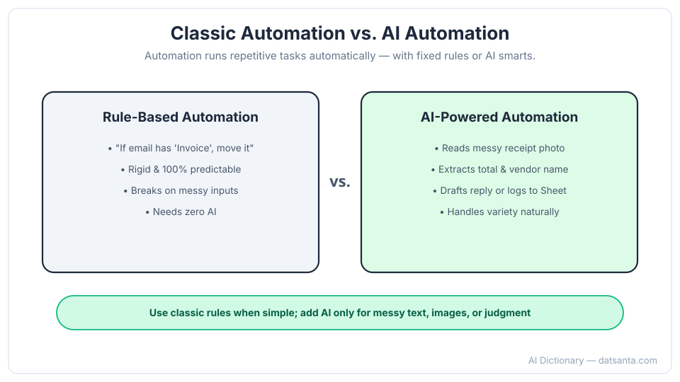

# Automation

**Automation** is using software or machines to carry out repetitive tasks automatically with little or no human effort — following fixed rules or AI-assisted steps.

## Everyday example

Setting a smart coffee maker to brew at 7:00 AM every weekday, or having your email inbox automatically move receipts into an "Invoices" folder, is classic automation.

Traditional automation handles predictable rules (*"If X happens, do Y"*). Pairing automation with AI lets workflows handle messy inputs too — like reading a photo of a handwritten receipt and typing the numbers into your spreadsheet.

## Don't confuse with

- **[AI](ai.md):** Most everyday automation (auto-replies, scheduled backups, assembly-line arms) works on rigid rules and does not use AI at all.
- **[AI workflow](ai-workflow.md):** An AI workflow is a modern type of automation that plugs an [LLM](llm.md) into business apps to summarize, classify, or draft text along the way.

## Related terms

- [AI Workflow](ai-workflow.md)
- [Algorithm](algorithm.md)
- [AI Agent](ai-agent.md)
- [AI](ai.md)
