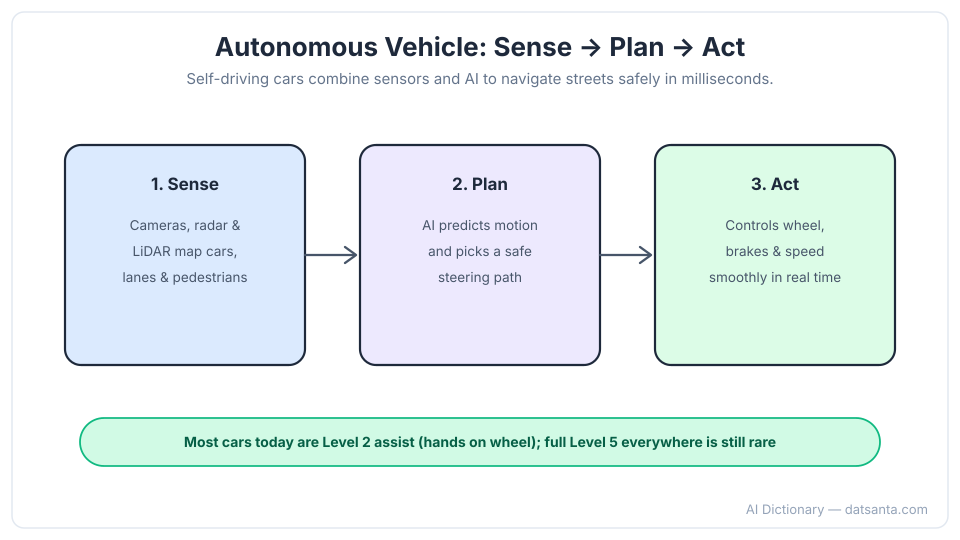

# Autonomous Vehicle

An **autonomous vehicle** (self-driving car, drone, or delivery robot) uses cameras, radar, sensors, and AI to perceive its surroundings, plan a safe path, and navigate with minimal or no human driving.

## Everyday example

Driving through a busy intersection requires spotting pedestrians, reading traffic lights, predicting whether a motorbike will merge, and steering smoothly — all in fractions of a second.

Autonomous vehicles run a continuous **Sense → Plan → Act** loop: [computer vision](computer-vision.md) and LiDAR map the street in 3D, AI predicts nearby movement, and onboard computers control steering, braking, and speed.

## Don't confuse with

- **Basic cruise control:** Standard cruise control only holds a fixed speed on an empty highway; autonomous systems steer, stop at red lights, and react to unexpected obstacles.
- **Fully driverless everywhere (Level 5):** Most cars on the road today are Level 2 driver-assistance (hands on wheel, eyes on road), while robotaxis operate only in mapped city zones.

## Related terms

- [Computer Vision](computer-vision.md)
- [AI Agent](ai-agent.md)
- [Deep Learning](deep-learning.md)
- [Sensor / Edge AI](local-ai.md)
