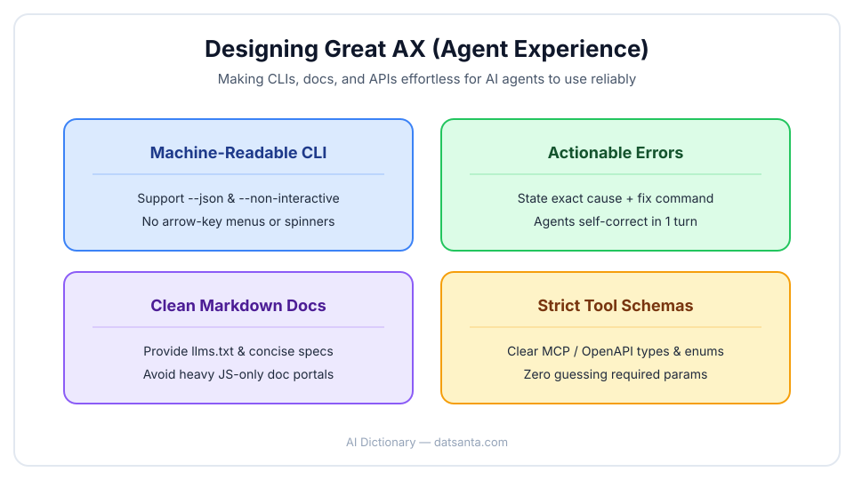

# AX (Agent Experience)

**AX (Agent Experience)** is how easy, unambiguous, and reliable it is for AI agents—not just human developers—to read your documentation, run your CLI tools, parse error messages, and use your APIs without getting stuck.

## Everyday example

Good DX (Developer Experience) adds pretty animated spinners and interactive arrow-key menus to a CLI. Those exact spinners and interactive prompts often *break* coding agents! Strong AX provides non-interactive `--json` flags, concise Markdown docs (like `llms.txt`), deterministic error messages with exact fix hints, and clean [MCP](mcp.md) schemas so both humans and agents succeed on the first try.

## Don't confuse with

- **[MCP (Model Context Protocol)](mcp.md):** MCP is one specific technical protocol for exposing tools to agents; AX is the broader design discipline covering CLI output, docs, error messages, and API ergonomics for agents.

## Related terms

- [MCP](mcp.md)
- [AGENTS.md](agents-md.md)
- [Structured Outputs](structured-outputs.md)
