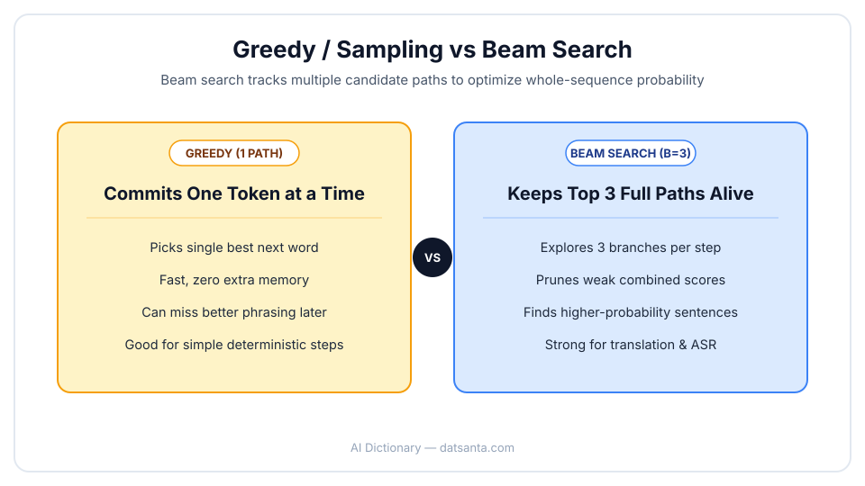

# Beam Search

**Beam search** is a decoding strategy that tracks the `B` most promising partial sequences at every step instead of committing greedily to one token, picking the sequence with the highest overall probability.

## Everyday example

When navigating mountain trails without a map, taking only the steepest upward path right in front of you might trap you on a small hill. Sending three scouts along the top three trails (`beam width = 3`) and keeping whichever routes stay strongest overall avoids dead ends. Beam search shines in translation or exact transcription, though open-ended chat models prefer [temperature](temperature.md) sampling for natural variety.

## Don't confuse with

- **[Top-k Sampling](top-k-sampling.md):** Top-k randomly samples one next token from `k` choices; beam search deterministically explores multiple parallel paths to maximize total sequence score.

## Related terms

- [Top-k Sampling](top-k-sampling.md)
- [Temperature](temperature.md)
- [Logits](logits.md)
