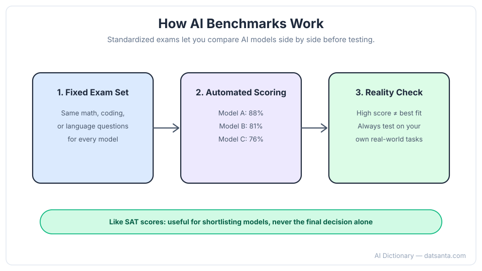

# Benchmark

A **benchmark** is a standardized exam — a fixed set of math, coding, language, or reasoning tests — used to score and compare how well different AI models perform side by side.

## Everyday example

Think of SAT scores or car crash-test ratings. They give you a quick way to compare two models (like Model A scoring 88% vs. Model B scoring 81% on coding tests) before trying them yourself.

However, just like students who memorize past exam sheets, an AI can score high on public benchmarks yet still feel clunky on *your* specific real-world tasks. Always test models on your own examples too.

## Don't confuse with

- **[Evals](evals.md):** Public benchmarks compare general models on universal tests; *evals* are private tests you build to measure how well an AI works on your exact app and data.
- **Real-world usefulness:** A model ranked #1 on academic math benchmarks is not automatically the best writer, translator, or cheapest choice for your daily work.

## Related terms

- [Evals](evals.md)
- [Dataset](dataset.md)
- [LLM](llm.md)
- [Reasoning Model](reasoning-model.md)
