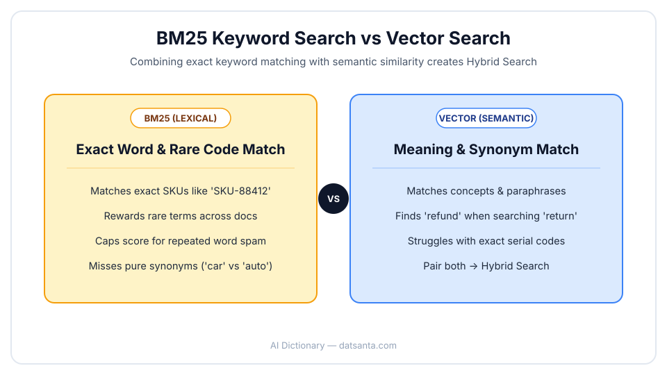

# BM25

**BM25** is a classic, fast keyword-matching ranking algorithm that scores documents by exact word matches while rewarding rare keywords and preventing repeated spam words from gaming the score.

## Everyday example

Suppose you search a parts catalog for `"SKU-88412 gasket"`. Semantic [embeddings](embeddings.md) might treat `"SKU-88412"` and `"SKU-88419"` as nearly identical numbers, whereas BM25 spots the exact rare code `"SKU-88412"` immediately and ranks that manual page #1. Combining BM25 with vector search creates [hybrid search](hybrid-search.md)—getting both exact codes and conceptual meaning right.

## Don't confuse with

- **[Cosine Similarity](cosine-similarity.md):** Cosine similarity compares dense semantic vectors to match synonyms and meaning; BM25 counts exact lexical terms and inverse document frequency.

## Related terms

- [Hybrid Search](hybrid-search.md)
- [Vector Database](vector-database.md)
- [Reranking](reranking.md)
