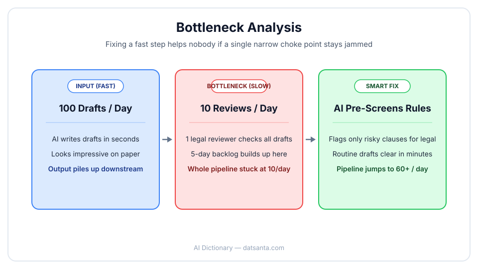

# Bottleneck Analysis

**Bottleneck analysis** is finding the single slowest or most overloaded step in a workflow that holds back everything else, so you apply AI where it actually speeds up the whole system.

## Everyday example

If a highway has four open lanes that suddenly narrow into one tollbooth, widening the four-lane section will not get cars home any faster. You have to fix the tollbooth. Likewise, using AI to write marketing drafts three times faster will not speed up publishing if every draft still sits for five days waiting on one legal reviewer. Always target the narrowest point first.

## Don't confuse with

- **[Process Mapping](process-mapping.md):** Process mapping draws the entire road from start to finish; bottleneck analysis identifies the exact traffic jam slowing the road down.

## Related terms

- [Use Case Prioritization](use-case-prioritization.md)
- [AI Strategy](ai-strategy.md)
- [AI KPI](ai-kpi.md)
