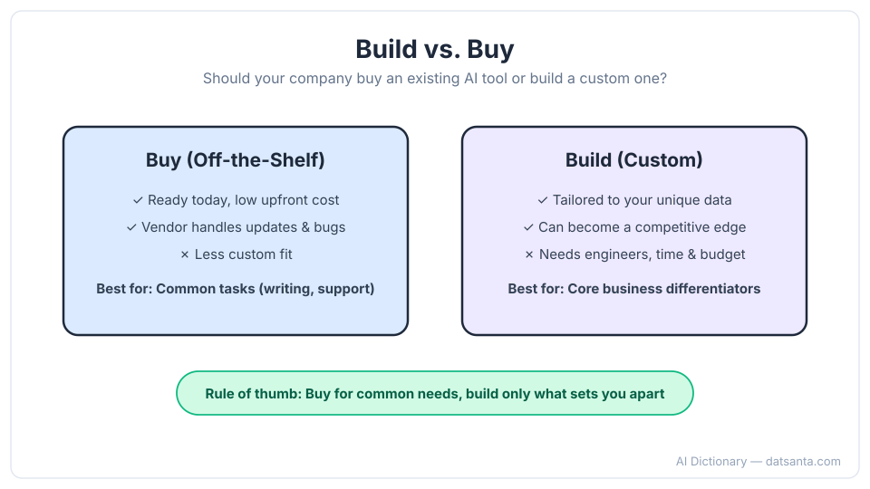

# Build vs. Buy

**Build vs. Buy** is the business decision between buying a ready-made AI tool off the shelf or paying engineers to build a custom system around your own data.

## Everyday example

A growing company needs delivery vans. Buying or leasing existing vans gets you on the road tomorrow with predictable costs. Designing and manufacturing your own van from scratch only makes sense if the vehicle itself is your core product.

Most companies should **buy** AI tools for everyday needs (meeting notes, writing, basic support) and only **build** custom AI where proprietary data gives them a real edge over competitors.

## Don't confuse with

- **[Fine-tuning](fine-tuning.md):** Fine-tuning customizes an existing model's behavior; build vs. buy is the broader business choice about owning software vs. subscribing to a tool.
- **[Vendor lock-in](vendor-lock-in.md):** Buying is faster, but relying completely on one vendor's closed platform can make switching painful later.

## Related terms

- [AI ROI](ai-roi.md)
- [Vendor Lock-in](vendor-lock-in.md)
- [Fine-tuning](fine-tuning.md)
