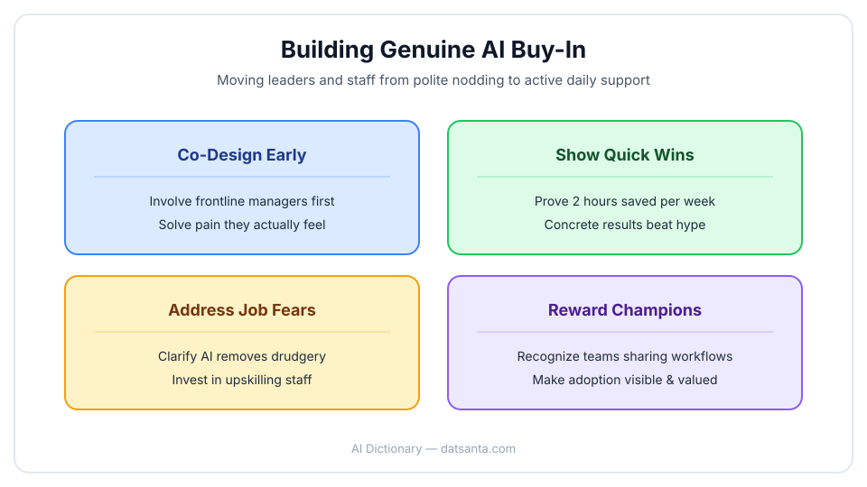

# Buy-In

**Buy-in** is genuine agreement and active support from leaders, managers, and frontline staff for an AI initiative—not just polite nodding in a kickoff meeting.

## Everyday example

A CEO can announce an "AI-first year" on stage, yet nothing changes if middle managers quietly fear looking replaceable or staff think the tool creates extra busywork. Real buy-in happens when team leads co-design the pilot, see how AI removes their least favorite paperwork, and actively encourage their teams to use it every week.

## Don't confuse with

- **[AI Adoption](ai-adoption.md):** Buy-in is the willingness and trust to support the change; adoption is the measurable daily usage that follows once people are on board.

## Related terms

- [Change Management](change-management.md)
- [AI Champion](ai-champion.md)
- [AI Strategy](ai-strategy.md)
