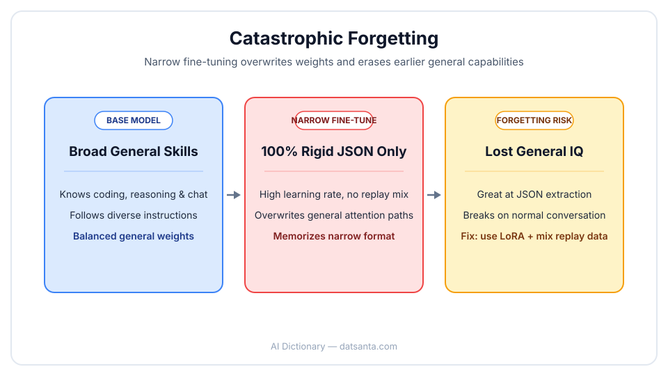

# Catastrophic Forgetting

**Catastrophic forgetting** happens when fine-tuning a model on a narrow new dataset overwrites its existing weights, causing it to abruptly lose general reasoning, coding, or instruction-following skills it already knew.

## Everyday example

Suppose a bilingual tour guide spends three months doing nothing but reciting rigid legal disclaimers in a courtroom, and suddenly forgets how to hold a casual dinner conversation. If you fine-tune an LLM exclusively on 5,000 strict JSON extraction examples with a high learning rate, it may get great at JSON while forgetting how to chat politely. Mixing general replay data or using [LoRA](lora.md) prevents it.

## Don't confuse with

- **Overfitting:** Overfitting means memorizing training examples so accuracy drops on unseen test cases of the *same* task; catastrophic forgetting means losing *earlier unrelated capabilities* after learning a new task.

## Related terms

- [Fine-tuning](fine-tuning.md)
- [LoRA](lora.md)
- [Regression Testing](regression-testing.md)
