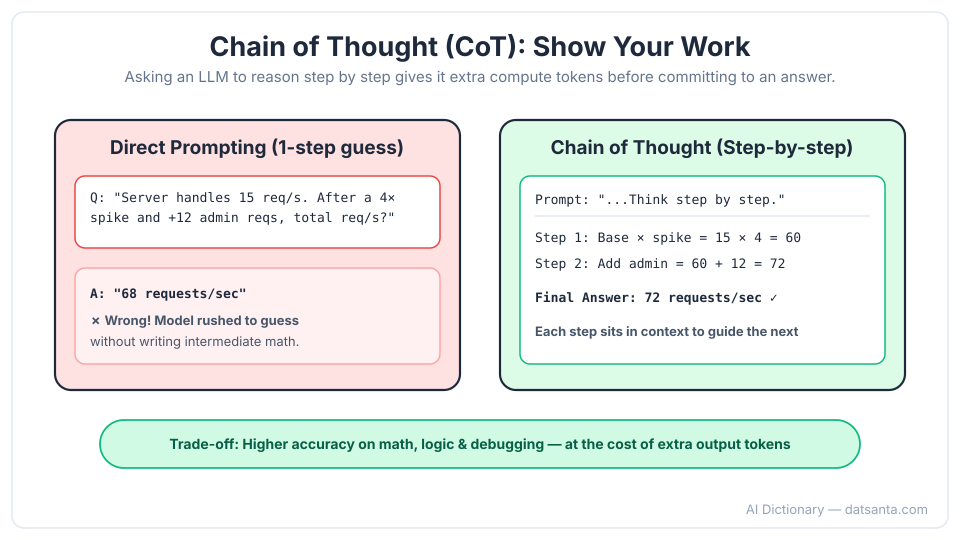

# Chain of Thought (CoT)

**Chain of thought** is a prompting and reasoning technique where an [LLM](llm.md) writes out intermediate reasoning steps before giving a final answer, boosting accuracy on math, logic, and multi-step debugging.

## Everyday example

If someone asks you *"What is 15 × 4 + 12?"* and forces you to shout a number in one second, you might slip up. Writing *"Step 1: 15 × 4 = 60. Step 2: 60 + 12 = 72"* on scratch paper prevents careless mistakes.

Because an LLM only "thinks" by generating [tokens](token.md), forcing a direct one-word answer starves it of compute. Letting it write reasoning steps places intermediate facts right into its [context window](context-window.md) to guide the final answer.

## Don't confuse with

- **Direct prompting:** Asking for just the answer; cheaper and faster for simple lookups, but brittle on multi-step reasoning.
- **Hidden reasoning tokens:** Modern "reasoning models" generate internal thinking tokens automatically behind the scenes before streaming the visible reply.

## Related terms

- [Prompt](prompt.md)
- [ReAct Pattern](react-pattern.md)
- [Context Window](context-window.md)
- [Token](token.md)
