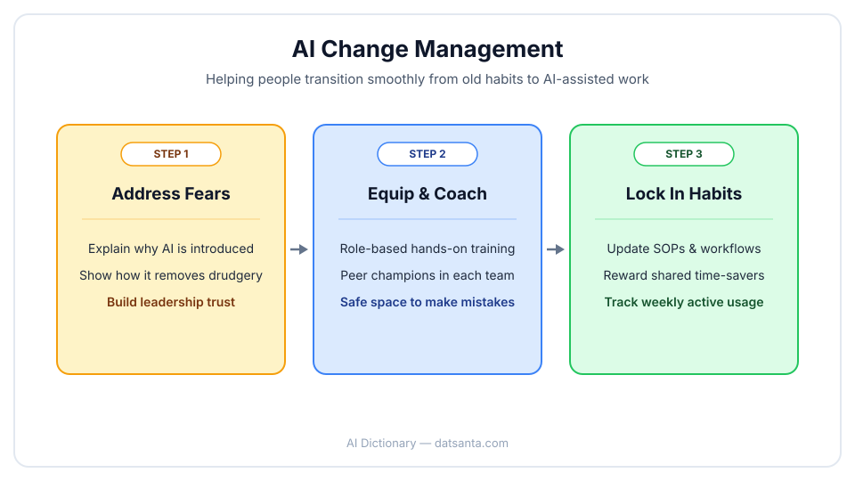

# Change Management

**Change management** is the structured effort to help employees understand, trust, and actually adopt new AI workflows in daily work — through clear communication, training, and listening to concerns.

## Everyday example

You can buy the best CRM or AI writing tool on the market, yet if managers simply email a login link on Monday morning, half the team will ignore it or fear it is meant to replace their jobs.

Good change management explains *why* the tool helps (*"It removes boring copy-pasting"*), trains team champions first, and adjusts workflows based on real staff feedback.

## Don't confuse with

- **IT deployment:** Installing software or handing out licenses is technical setup; change management is the human side of changing daily work habits.
- **[AI enablement](ai-enablement.md):** Enablement gives staff training, prompt libraries, and tools; change management aligns leadership, incentives, and culture around the shift.

## Related terms

- [AI Adoption](ai-adoption.md)
- [AI Enablement](ai-enablement.md)
- [Shadow AI](shadow-ai.md)
- [Productivity J-Curve](productivity-j-curve.md)
