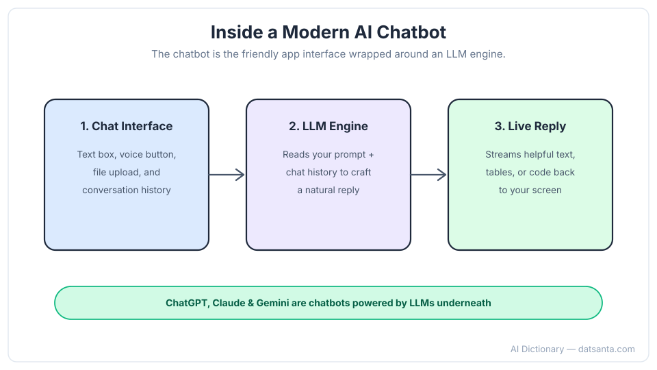

# Chatbot

A **chatbot** is an app with a conversation interface where you type or speak questions and receive human-like replies from an AI model (such as ChatGPT, Claude, or Gemini).

## Everyday example

Older website chatbots worked like automated phone menus: press 1 for shipping, press 2 for billing, and anything unexpected got *"Sorry, I didn't understand."*

Modern AI chatbots powered by [LLMs](llm.md) understand open-ended questions, remember earlier messages in the thread, summarize uploaded files, and hold natural back-and-forth conversations.

## Don't confuse with

- **[LLM](llm.md):** The LLM is the AI brain running on servers; the chatbot is the chat window, buttons, and conversation history built around that brain.
- **[AI agent](ai-agent.md):** A chatbot mostly talks and drafts answers for you; an AI agent can plan steps and take actions across apps on your behalf.

## Related terms

- [LLM](llm.md)
- [Copilot](copilot.md)
- [AI Agent](ai-agent.md)
- [Prompt](prompt.md)
