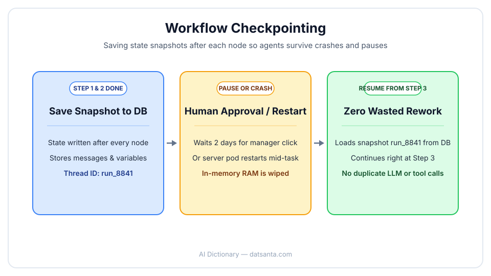

# Checkpointing

**Checkpointing** saves a complete snapshot of an agent's state—messages, variables, and current step—to a database after every node so long-running workflows can pause, survive crashes, or resume days later.

## Everyday example

Video games auto-save at checkpoints before tough boss fights so a power outage does not send you back to Level 1. In production agents, if a workflow pauses for a manager's Slack approval or a server restarts mid-run, checkpointing lets the [state machine](state-machine.md) reload the exact saved snapshot and continue from step 4 instead of re-running costly LLM calls.

## Don't confuse with

- **[Agent Memory](agent-memory.md):** Agent memory stores user facts or preferences across *different* conversations; checkpointing persists exact execution snapshots to resume a *single* workflow run reliably.

## Related terms

- [State Machine](state-machine.md)
- [Human-in-the-Loop](human-in-the-loop.md)
- [Idempotency](idempotency.md)
