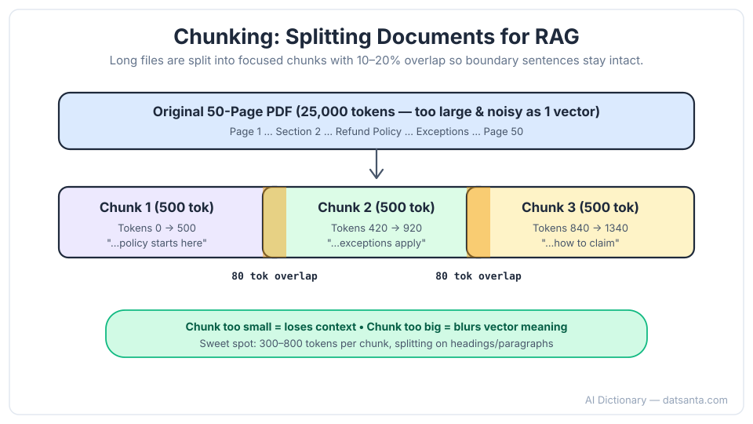

# Chunking

**Chunking** splits long documents (like 50-page PDFs or codebases) into smaller, focused pieces before turning them into [embeddings](embeddings.md) for [RAG](rag.md), usually with a 10–20% overlap between neighbors.

## Everyday example

If you grind an entire cookbook into a single vector, searching for `"pasta sauce"` returns vague noise. Cut the book into individual recipes of 300–800 [tokens](token.md), and each search hits the exact recipe needed.

Adding an overlap (say 80 tokens shared between Chunk 1 and Chunk 2) ensures a crucial rule sitting right at a page break does not get chopped in half.

## Don't confuse with

- **[Tokenization](token.md):** Tokenization splits text into tiny subword pieces for the model; chunking splits whole documents into paragraph-sized blocks for retrieval.
- **Fixed-character slicing:** Cutting blindly every 1,000 characters often breaks mid-sentence or mid-table; smart chunkers split cleanly on Markdown headings and paragraph boundaries.

## Related terms

- [RAG](rag.md)
- [Embeddings](embeddings.md)
- [Vector Database](vector-database.md)
- [Context Window](context-window.md)
