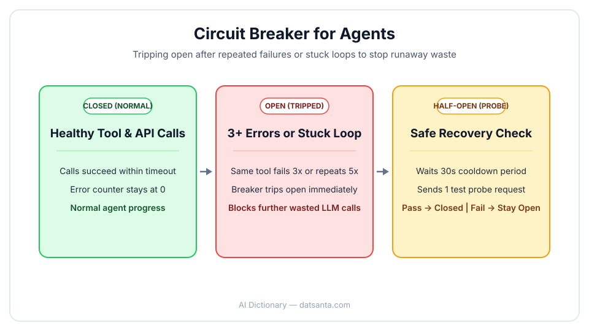

# Circuit Breaker

A **circuit breaker** is a reliability safeguard that stops an AI app or agent from repeatedly calling a failing API or running an infinite broken tool loop—tripping open after `N` failures to fail fast or route to a safe fallback.

## Everyday example

When a kitchen toaster shorts out, the home circuit breaker trips off instantly instead of letting wires overheat and burn down the house. In agentic code, if an external CRM tool returns `503` five times in a row—or an agent calls the same search tool 8 times with identical arguments—a circuit breaker halts the loop immediately, saving latency, rate-limit quota, and runaway token bills.

## Don't confuse with

- **[Rate Limiting](rate-limiting.md):** Rate limiting caps how many requests are allowed per minute under normal traffic; a circuit breaker detects repeated *failures or stuck loops* and cuts off calls until health recovers.

## Related terms

- [Fallback Chain](fallback-chain.md)
- [State Machine](state-machine.md)
- [Token Budget](token-budget.md)
