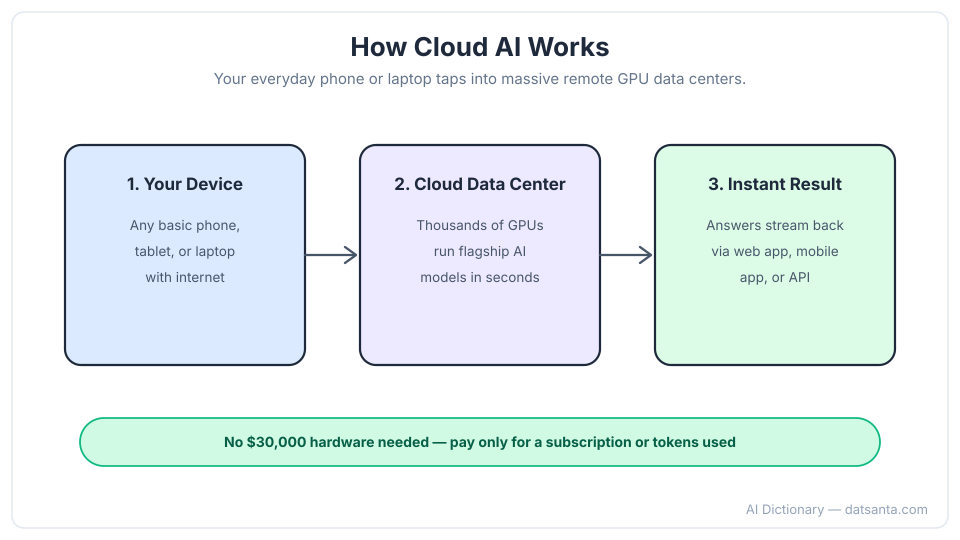

# Cloud AI

**Cloud AI** means using powerful AI models hosted on remote data centers over the internet — through a website, mobile app, or API — instead of running them on your own computer.

## Everyday example

Just like streaming movies on Netflix or saving files on Google Drive, you do not need to buy a $30,000 server GPU to use the world's smartest AI models. You type a [prompt](prompt.md) on a basic laptop or phone, remote data centers do the heavy math in seconds, and the answer streams back.

The trade-off is requiring internet access, paying subscription or per-[token](token.md) fees, and checking the provider's [data privacy](data-privacy.md) terms.

## Don't confuse with

- **[Local AI](local-ai.md):** Local AI runs directly on your personal device offline; cloud AI runs on the provider's remote GPUs.
- **Cloud storage:** Storing a PDF in Dropbox just keeps files safe; cloud AI actively runs model [inference](inference.md) on remote compute clusters.

## Related terms

- [Local AI](local-ai.md)
- [Open-Source AI](open-source-ai.md)
- [Data Privacy](data-privacy.md)
- [Inference](inference.md)
